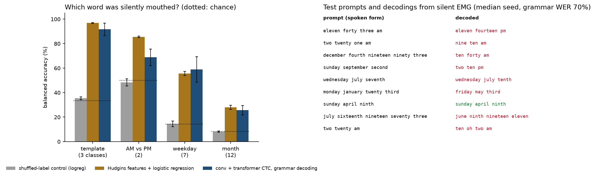
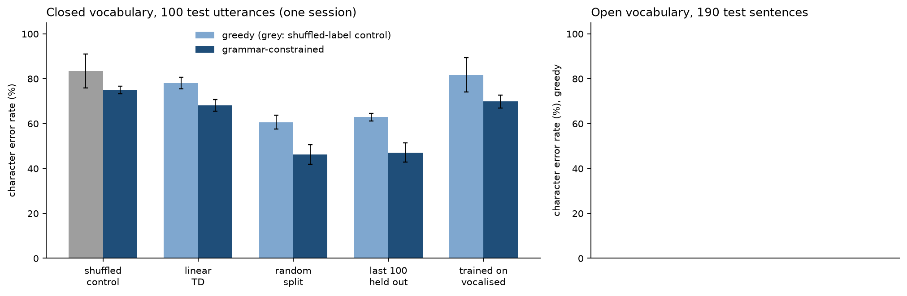
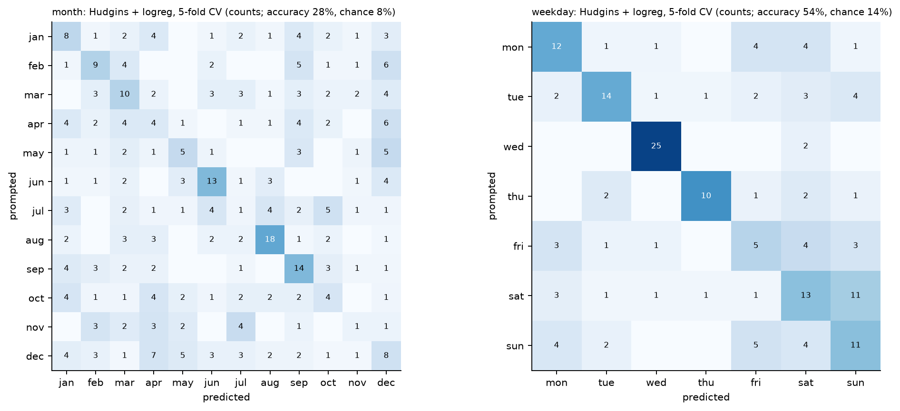
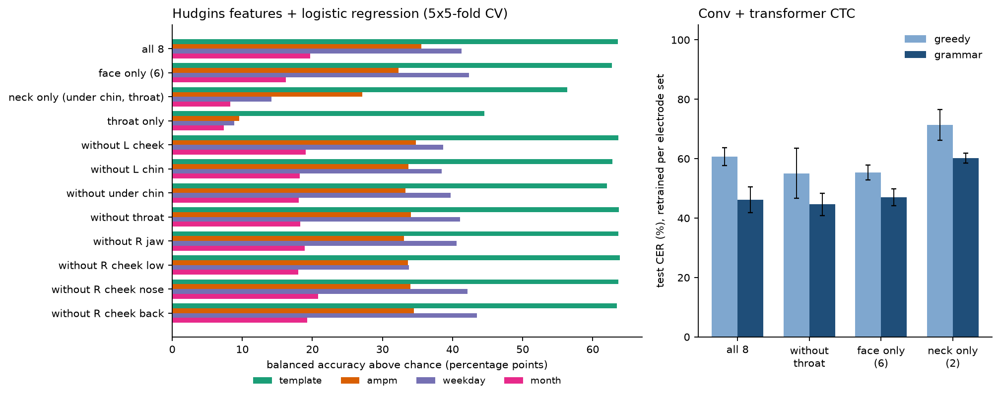

# silent-emg: reading silently mouthed dates and times from face and neck muscles



It reads silently mouthed dates and times ("monday june thirtieth", "eight eleven pm") from eight surface EMG electrodes on the face and neck, using the public recordings of one speaker by Gaddy & Klein (2020). On 100 held-out utterances, a small convolution + transformer CTC model with a date/time grammar has a 70% word error rate, against 96% for the same model trained on shuffled labels, and names the weekday in 59% of cases (balanced accuracy, chance 14%). A logistic regression on classic time-domain features comes close on the single-word questions (weekday 56% under cross-validation).

<!-- TODO(Tommaso): your own words on why -->

## Usage

```bash
python -m venv .venv && source .venv/bin/activate
pip install -r requirements.txt

# 1. data: 3.9 GB archive from Zenodo (CC BY 4.0), checksum md5:7f97d2182b896652999b1b2d0c69fd7b
mkdir -p data/raw && cd data/raw
curl -L -o emg_data.tar.gz "https://zenodo.org/records/4064409/files/emg_data.tar.gz?download=1"
tar xzf emg_data.tar.gz --exclude='*.flac' emg_data/closed_vocab emg_data/silent_parallel_data
cd ../..

# 2. filter once and cache as memory-mapped float32 (about 480 MB)
python scripts/prepare_data.py

# 3. experiments
python scripts/run_classical.py        # Hudgins features + logreg / GBM, a few minutes on CPU
python scripts/run_experiments.py      # CTC models, one run at a time, resumable (hours on an M-series Mac)
python scripts/grammar_decode.py       # re-decode saved CTC outputs with the date/time grammar
python scripts/make_figures.py         # results/summary.md and figures/
python scripts/plot_raw.py             # figures/raw_emg_example.png

# tests (synthetic data only, no download)
python -m pytest -q
```

`run_experiments.py` waits before each run until macOS reports at least 25% free memory, trains one model at a time, and appends each finished run to `results/runs.jsonl`, so it can be stopped and restarted.

## Results

All numbers are on held-out test utterances, mean ± sample standard deviation over training seeds (the data split is fixed). Full tables, including every electrode subset, are in [results/summary.md](results/summary.md); raw per-run records are in `results/runs.jsonl`, `results/grammar.json` and `results/classical.json`.

### Closed vocabulary: sentence decoding (CTC)

100 test utterances, 370 train, 30 validation, one recording session. WER and CER are on the spoken-form text.

| model | seeds | CER % greedy | CER % grammar | WER % grammar |
|---|---|---|---|---|
| best single constant sentence (picked using the test labels) | | 70.2 | | 98.5 |
| conv + transformer, shuffled labels (control) | 3 | 83.4 ± 7.5 | 74.9 ± 1.7 | 96.2 ± 4.6 |
| linear on Jou TD features | 3 | 78.0 ± 2.6 | 68.1 ± 2.7 | 92.2 ± 3.2 |
| conv + transformer | 5 | 60.6 ± 3.0 | 46.2 ± 4.4 | 70.0 ± 5.8 |
| conv + transformer, initialised from the open-vocabulary model | 3 | 54.9 ± 2.2 | 47.6 ± 1.8 | 73.9 ± 3.4 |

Greedy WER is about 100% for every model: without the grammar almost no word is spelled exactly right. With the grammar, the network recovers part of the prompt; under 2% of test sentences are fully correct. A single constant sentence already reaches 70% CER, so greedy CER alone says little; the grammar WER is the number to read. Initialising from the held-out-session open-vocabulary model below (seed 0) lowers greedy CER by about 6 points but does not change grammar WER.



| condition (conv + transformer, 3 seeds) | CER % grammar | WER % grammar |
|---|---|---|
| random split (5 seeds, from above) | 46.2 ± 4.4 | 70.0 ± 5.8 |
| contiguous split: last 100 recordings held out | 47.1 ± 4.2 | 72.7 ± 6.6 |
| trained on vocalised EMG only, tested on silent | 69.8 ± 2.9 | 90.0 ± 2.2 |

Holding out the last 100 recordings instead of a random 100 costs about 3 WER points, within one standard deviation. Training on vocalised EMG of the same prompts and testing on silent EMG is close to the shuffled-label control, which matches the gap between speaking modes that motivated the original paper.

### Closed vocabulary: which word was mouthed

The templates give four closed-set questions. Balanced accuracy %, chance in the second column.

| task | chance | Hudgins + logreg, 5x5-fold CV | Hudgins + GBM, CV | logreg, contiguous folds | logreg, shuffled labels | log duration only |
|---|---|---|---|---|---|---|
| template (3) | 33.3 | 96.9 ± 0.3 | 94.5 ± 0.2 | 97.2 | 35.4 ± 1.1 | 61.6 ± 0.8 |
| AM vs PM (2) | 50.0 | 85.5 ± 0.6 | 82.3 ± 0.4 | 84.6 | 48.4 ± 2.8 | 50.1 ± 1.5 |
| weekday (7) | 14.3 | 55.6 ± 1.7 | 46.8 ± 1.8 | 52.0 | 14.6 ± 2.3 | 13.1 ± 1.7 |
| month (12) | 8.3 | 28.0 ± 1.7 | 24.2 ± 1.8 | 25.2 | 8.1 ± 0.5 | 11.0 ± 0.7 |

On the same 100 test utterances as the CTC models:

| task | logreg | GBM | conv + transformer, grammar (5 seeds) |
|---|---|---|---|
| template | 99.0 | 95.0 | 91.7 ± 5.1 |
| AM vs PM | 85.6 | 79.3 | 68.8 ± 6.7 |
| weekday | 43.6 | 51.9 | 58.9 ± 10.5 |
| month | 19.7 | 24.0 | 25.7 ± 3.9 |

A per-slot classifier on 201 hand-crafted features is as good as the sequence model on these questions; on 100 test items the differences between them are inside the noise (one weekday test item is about 3 points). Template identity is partly given away by duration (61.6% from duration alone), the other three are not.



Saturday and Sunday are the most confused weekdays, and the month confusions are spread out with June, August and September recognised best.

### Electrode ablation

Each model is retrained on the electrode subset.

| electrodes | logreg weekday (CV) | logreg month (CV) | conv + transformer WER % grammar (3 seeds) |
|---|---|---|---|
| all 8 | 55.6 ± 1.7 | 28.0 ± 1.7 | 70.0 ± 5.8 (5 seeds) |
| without throat | 55.4 ± 2.5 | 26.6 ± 0.5 | 68.7 ± 5.3 |
| face only (6) | 56.7 ± 1.4 | 24.5 ± 0.2 | 72.5 ± 3.4 |
| neck only (under chin + throat) | 28.5 ± 2.3 | 16.6 ± 2.1 | 84.4 ± 2.5 |
| throat only | 23.1 ± 2.7 | 15.7 ± 1.7 | not run |



For silent articulation the face electrodes carry most of the information. Removing the throat electrode changes nothing measurable; the two neck electrodes alone keep the template and AM/PM questions well above chance but lose most of the weekday and month information. Dropping any single face electrode costs at most a few points; the largest single drop is the right cheek below the mouth (weekday 55.6 to 48.0).

### Open vocabulary: held-out session

Sentences from books, 7 silent sessions with electrodes re-attached each time. Train on 5 sessions, validate on 5-10, test on 5-11 (190 sentences). Greedy decoding, no language model.

| split | seeds | CER % | WER % |
|---|---|---|---|
| held-out session 5-11 | 2 | 75.5 ± 0.0 | 98.7 ± 0.3 |
| random utterances, same sizes | 1 | 80.0 | 98.4 |
| held-out session, shuffled labels (control) | 1 | 99.1 | 99.7 |

On an unseen session the character error rate is 75%, against 99% for the control, so the EMG carries character-level information across an electrode re-attachment; word-level output is unusable without a language model. Mixing sessions at random did not help here (one seed, 80.0% versus 75.5%), so on this data I see no sign of a session leak inflating random-split scores; with one seed this is weak evidence either way. Seed 1 and the control used a smaller batch budget than seed 0 (32k instead of 64k samples per batch) after an out-of-memory error on the shared machine.

### Comparison with Gaddy & Klein (2020)

The paper reports, on the closed vocabulary, 3.6% WER for its full model, 88.8% for a direct-transfer baseline trained on vocalised EMG only, and 64.6% for that baseline without the throat electrode (Table 4). These numbers are not like-for-like with mine:

- Their WER is a human listener transcribing synthesised audio (20 outputs per system), told the prompts are dates and times. Mine is automatic, on text decoded directly from EMG, over 100 test utterances.
- Their models were trained on the full open-vocabulary data (about 18.6 hours including vocalised EMG and audio) and then fine-tuned on the closed set, with audio-derived targets aligned to the silent EMG. Mine sees only the 370 silent closed-vocabulary training utterances (plus, in the initialised row, 1030 open-vocabulary silent utterances).
- The split sizes match (370 / 30 / 100), the indices do not.

What does compare in direction: training on vocalised EMG and testing on silent EMG transfers poorly in both (their 88.8% WER, my 90.0% grammar WER against 70.0% when trained on silent EMG). Their baseline improved a lot without the throat electrode (88.8 to 64.6); in my silent-trained models the throat electrode makes no measurable difference, which fits their explanation that the throat channel mainly differs between speaking modes.

Later work by the same author reports about 28% WER on open-vocabulary silent EMG with direct EMG-to-text recognition trained on the full dataset (Gaddy, 2022; figure quoted from the README of dgaddy/silent_speech). The open-vocabulary rows here use 2.0 hours of silent training data, no audio, no vocalised data and no language model, so it is a lower reference point, not a replication.

## Method

### Data and targets

Eight monopolar surface EMG channels at 1000 Hz (OpenBCI Cyton) from one speaker. Electrode sites, from Table 3 of Gaddy & Klein (2020):

| ch | site | group |
|---|---|---|
| 1 | left cheek just above mouth | face |
| 2 | left corner of chin | face |
| 3 | below chin, back 3 cm | neck |
| 4 | throat, 3 cm left of Adam's apple | neck |
| 5 | mid-jaw right | face |
| 6 | right cheek just below mouth | face |
| 7 | right cheek 2 cm from nose | face |
| 8 | back of right cheek, 4 cm in front of ear | face |

The closed-vocabulary set is 500 prompts drawn from three templates: `08:11 PM`, `July 07 2018`, `Monday June 30`. The prompts are written, but the speaker articulated words, so targets are converted to a spoken form (`eight eleven pm`, `july seventh twenty eighteen`, `monday june thirtieth`) by `silent_emg/spoken.py`. Two readings are a guess: years 2000 to 2009 become `two thousand X`, and `:00` becomes `oclock`. My conversion yields 73 distinct words; the paper reports 67, so the speaker's readings differ from mine in a few places.

### Preprocessing

Per channel, zero-phase IIR notches at 60 Hz and each harmonic below Nyquist (quality factor 30), then a zero-phase 4th-order Butterworth band-pass from 2 to 450 Hz. The previous and next recording are concatenated before filtering so that filter transients fall outside the utterance. For the raw-signal model the signal is then decimated to 500 Hz with a zero-phase FIR anti-alias filter, and every channel is z-scored with mean and standard deviation from the training split only.

### Classical features

Utterance-level (slot classification). For a segment $x_1..x_N$ of one channel, with dead-zone $\varepsilon = 0.01\,\sigma_x$, the Hudgins et al. (1993) features are

$$
\mathrm{MAV} = \frac{1}{N}\sum_n |x_n|,\qquad
\mathrm{WL} = \frac{1}{N}\sum_n |x_{n+1}-x_n|,
$$

$$
\mathrm{ZC} = \frac{1}{N}\sum_n \mathbb{1}\left[x_n x_{n+1} < 0 \wedge |x_{n+1}-x_n| \ge \varepsilon\right],\qquad
\mathrm{SSC} = \frac{1}{N}\sum_n \mathbb{1}\left[(x_n - x_{n-1})(x_n - x_{n+1}) > 0\right]\ \text{(same dead-zone)},
$$

plus $\log \mathrm{RMS}$ ($\log$ is also applied to MAV and WL). They are computed on the whole utterance and on 4 equal-length quarters, for all 8 channels, plus $\log$ duration: $5 \times 8 \times 5 + 1 = 201$ features. Classifiers: L2 logistic regression on standardised features ($C = 0.1$), and histogram gradient boosting (200 iterations, learning rate 0.05, 15 leaves).

Frame-level (linear CTC baseline). Following Jou et al. (2006), each channel is split into a low-frequency part $w = \bar{\bar{x}}$ (two passes of a 9-point moving average) and a high-frequency part $p = x - w$, with $r = |p|$. On 27 ms frames with a 10 ms hop:

$$
f = \left[\tfrac{1}{n}\sum w^2,\ \tfrac{1}{n}\sum w,\ \tfrac{1}{n}\sum p^2,\ \mathrm{ZCR}(p),\ \tfrac{1}{n}\sum r,\ \mathrm{WL},\ \mathrm{SSC}\right],
$$

stacked over $\pm 7$ frames (840 dimensions), followed by one linear layer and a softmax per frame.

### Neural model

Raw 500 Hz EMG goes through three residual 1D convolution blocks (kernel 3, GELU, batch norm; strides 2, 2, 1; 32, 64, 128 channels), giving 125 frames per second, then sinusoidal positions and a 3-layer pre-norm Transformer encoder ($d = 128$, 4 heads, feed-forward 384, dropout 0.3), then a linear layer over 37 characters plus the CTC blank (0.6 M parameters). Training augmentation: per-channel gain $\sim \mathcal{N}(1, 0.1)$, additive noise $\sigma = 0.05$, and two zeroed time spans of up to 80 ms.

### Training objective and decoding

Both sequence models are trained with connectionist temporal classification (Graves et al., 2006). With $\mathcal{B}$ the map that removes repeats and then blanks,

$$
\mathcal{L} = -\log \sum_{\pi \in \mathcal{B}^{-1}(y)} \prod_{t=1}^{T} p_\theta(\pi_t \mid x).
$$

AdamW (learning rate $10^{-3}$ for the network, $3 \cdot 10^{-3}$ for the linear model, weight decay 0.01), linear warm-up then cosine decay, batch 16, gradient clipping at 1. The checkpoint with the lowest validation CER is kept.

Two decoders are reported. Greedy decoding takes $\arg\max_k p(k \mid x_t)$ per frame and applies $\mathcal{B}$. Grammar decoding searches only over sentences the three templates can produce (hours 1 to 12, minutes, am/pm, months, ordinal days 1 to 31, weekdays, and every year in the range seen in training): the grammar is compiled into a graph of character states with the CTC blank topology, and Viterbi search returns

$$
\hat{y} = \arg\max_{y \in G} \max_{\pi \in \mathcal{B}^{-1}(y)} \sum_t \log p_\theta(\pi_t \mid x).
$$

### Metrics

$\mathrm{CER} = (S + D + I) / N$ over characters of the spoken-form text, $\mathrm{WER}$ the same over words. Slot accuracy is balanced accuracy (mean per-class recall); for the CTC models the slot is read off the decoded text.

### Evaluation protocol

- Random split: 370 train / 30 validation / 100 test utterances, the sizes used by Gaddy & Klein (2020) (their indices were not released for the closed set, so mine are a fresh random draw with seed 0). The split is fixed; seeds change initialisation, batch order and augmentation.
- Contiguous split: the last 100 recordings are the test set, the 30 before them validation. All 500 closed-vocabulary utterances come from one session, so this is the closest available proxy for a later recording.
- Held-out session (open vocabulary): train on 5 silent sessions, select on session 5-10, test on session 5-11. Electrodes were re-attached between sessions. A random-utterance split of the same sizes is the comparison.
- Shuffled-label control: training and validation transcripts are permuted across utterances; the test labels stay true. Whatever such a model scores comes from the label distribution alone.
- Electrode ablation: the model is retrained on the subset of channels (they are removed, not zeroed).
- Classical slot classifiers: 5-fold cross-validation repeated 5 times with different stratified folds, plus 5 contiguous folds; also trained on the 400 non-test utterances of the random split and scored on the same 100 test utterances as the CTC models.

## Data and licenses

- Dataset: Gaddy, D. (2020). Silent Speech EMG. Zenodo. [10.5281/zenodo.4064409](https://doi.org/10.5281/zenodo.4064409). License: Creative Commons Attribution 4.0 International (checked through the Zenodo and DataCite APIs). One file, `emg_data.tar.gz`, 3.92 GB. This repository uses `closed_vocab/` (500 silent and 500 vocalised utterances, one session) and `silent_parallel_data/` (1588 silent utterances, 7 sessions); audio files are not extracted.
- No data is committed. `data/` is git-ignored.
- The preprocessing follows the published description in Gaddy & Klein (2020) and the MIT-licensed reference code at [dgaddy/silent_speech](https://github.com/dgaddy/silent_speech); no code is copied from it.
- Code in this repository: MIT.

## Limitations

- One speaker. Nothing here says how the models would do on another person, and the per-person variation of facial EMG is large.
- The closed-vocabulary set is a single session, so the "held-out" closed-vocabulary numbers never cross an electrode re-attachment. The only cross-session number is the open-vocabulary row, from one test session and 2 seeds.
- 100 test utterances. One utterance is 1% WER-weight and 2 to 4 points of slot accuracy; seed-to-seed standard deviations of 5 to 10 points mean that differences under about 5 WER points between rows are not reliable.
- The spoken-form targets are my reading of the written prompts and were not checked against the audio. My conversion has 73 words, the paper reports 67, so some prompts were read differently (likely years and ordinals). Those words are scored as errors even when the model follows the speaker.
- Grammar decoding uses knowledge of the prompt templates and of the year range in the training prompts. It is a strong prior and makes the task easier than open recognition.
- The neural model was tuned only lightly (one learning-rate check on the validation set of the closed vocabulary) and is small (0.6 M parameters) to fit the memory limits of a shared laptop. Larger models, more augmentation, or pretraining on the vocalised and audio data would probably help; I did not try them.
- Open-vocabulary training skips utterances longer than 15 s (7% of training utterances) and stops at 40 epochs; validation CER had levelled off by then (0.78 at epochs 30 and 40 for seed 0).
- The slot classifiers and the CTC models are scored on different evaluation schemes in the first slot table (cross-validation versus one 100-utterance test set); the second slot table puts them on the same test set.

## References

- Gaddy, D., & Klein, D. (2020). Digital Voicing of Silent Speech. Proceedings of EMNLP 2020, 5521-5530. [10.18653/v1/2020.emnlp-main.445](https://doi.org/10.18653/v1/2020.emnlp-main.445)
- Gaddy, D. (2020). Silent Speech EMG [dataset]. Zenodo. [10.5281/zenodo.4064409](https://doi.org/10.5281/zenodo.4064409)
- Gaddy, D., & Klein, D. (2021). An Improved Model for Voicing Silent Speech. Proceedings of ACL-IJCNLP 2021 (short papers). [10.18653/v1/2021.acl-short.23](https://doi.org/10.18653/v1/2021.acl-short.23)
- Jou, S.-C., Schultz, T., Walliczek, M., Kraft, F., & Waibel, A. (2006). Towards continuous speech recognition using surface electromyography. Interspeech 2006. [10.21437/Interspeech.2006-212](https://doi.org/10.21437/Interspeech.2006-212)
- Hudgins, B., Parker, P., & Scott, R. N. (1993). A new strategy for multifunction myoelectric control. IEEE Transactions on Biomedical Engineering, 40(1), 82-94. [10.1109/10.204774](https://doi.org/10.1109/10.204774)
- Graves, A., Fernández, S., Gomez, F., & Schmidhuber, J. (2006). Connectionist temporal classification. Proceedings of ICML 2006. [10.1145/1143844.1143891](https://doi.org/10.1145/1143844.1143891)
- Gaddy, D. (2022). Voicing Silent Speech. PhD dissertation, UC Berkeley, Technical Report UCB/EECS-2022-68. https://www2.eecs.berkeley.edu/Pubs/TechRpts/2022/EECS-2022-68.html (no DOI)
- Vaswani, A., et al. (2017). Attention Is All You Need. NeurIPS 2017. [10.48550/arXiv.1706.03762](https://doi.org/10.48550/arXiv.1706.03762)
